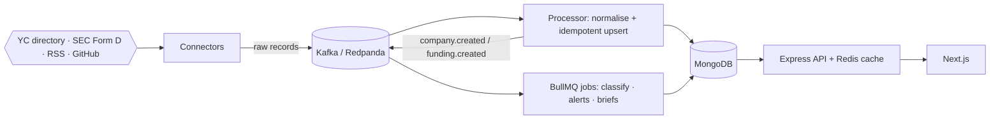

# Strata

**Startup and sector intelligence from public data.** Strata tracks startups in chosen sectors, records their funding rounds from primary sources, classifies companies into an editable sector taxonomy with LLMs (with a confidence score and a human review queue), and produces sector landscapes and analyst briefs in which every claim cites a stored source.

> **Name.** *Strata* is the proposed product name: a landscape is read in layers, from sector to subsector to company to round to source. The repository is `AN`. Alternatives considered are in [docs/DECISIONS.md](docs/DECISIONS.md#001--name-strata).

| | |
|---|---|
| **Backend** | Node.js 22 · Express 5 · TypeScript · Mongoose 8 (MongoDB 7, aggregation pipelines) · zod |
| **Frontend** | Next.js 15 (App Router) · React 19 · SWR · Tailwind |
| **Infra** | Redpanda (Kafka API) event backbone · Redis (cache, rate limits, BullMQ jobs) · Docker Compose |
| **AI** | OpenAI, Anthropic and Gemini behind one provider interface (structured outputs + zod re-validation), plus an offline heuristic baseline; a 162-company eval set |
| **Data** | YC public directory · SEC EDGAR Form D · company RSS/press feeds · GitHub. No Crunchbase, PitchBook, Tracxn or LinkedIn scraping. |

**Read next:** [Architecture](docs/ARCHITECTURE.md) · [Decisions log](docs/DECISIONS.md) · [Legal AI landscape (sample analysis)](docs/landscape-legal-ai.md) · [Eval results](docs/eval-results.md)

---

## Quick start

Requirements: Docker with Compose v2. Nothing else; no API keys needed.

```bash
docker compose up --build
```

Open **http://localhost:3000** and sign in:

| Role | Email | Password |
|---|---|---|
| Analyst | `analyst@strata.local` | `strata-demo-2026` |
| Admin | `admin@strata.local` | `strata-demo-2026` |
| Viewer | `viewer@strata.local` | `strata-demo-2026` |

The one-shot `seed` service loads a snapshot of real public data (465 YC companies across Legal AI, Climate Tech and Payments Infrastructure, plus 136 hand-verified SEC Form D filings) through the real ingestion pipeline, so the app is full on first run. The seed does nothing if the database already has data.

To enable LLM providers, copy `.env.example` to `.env` and add any of `OPENAI_API_KEY`, `ANTHROPIC_API_KEY` or `GEMINI_API_KEY`. Keys stay on the server and are never sent to the browser.

Optional: `docker compose --profile tools up` adds Redpanda Console at http://localhost:8080 to inspect topics and consumer groups.

## Features

| Feature | Where |
|---|---|
| **Company profiles**: description, HQ, team, tags, linked SEC entities, every source | `/companies/[slug]` |
| **Funding-round timeline**, each entry linked to its SEC filing or press release | Company profile, `/funding` |
| **Sector taxonomy management**: add, edit and delete sectors and subsectors; definitions feed the classifier | `/sectors` |
| **LLM classification** with confidence, rationale, alternatives and history; re-run with any configured provider | Company profile |
| **Human review queue**: low-confidence labels, keyboard-driven (`j`/`k`, `a` accept, `1–9` override, `0` out of scope) | `/review` |
| **Sector landscape**: market map, Form D funding by year, YC cohort trend, notable companies, latest rounds | `/sectors/[slug]` |
| **Search and filters**: full-text and prefix search; sector, subsector, status, review state, funding; URL-shareable | `/companies`, ⌘K palette |
| **Watchlists and alerts** for new rounds, by company or subsector, with a minimum size and optional SSRF-safe webhooks | `/watchlists`, `/alerts` |
| **Analyst briefs**: LLM-drafted; claims without a valid citation, or with numbers not found in the cited source, are dropped | `/briefs` |
| **CSV export** of companies and rounds (streamed, formula-injection safe) | Companies, funding and landscape pages |

Keyboard: `⌘K` / `Ctrl+K` or `/` search, `g` then `d c f s r w a b` to jump between pages, `j`/`k` and `Enter` in tables.

## How it works



The event bus is an interface with Kafka, Redis Streams and in-memory transports. A hosted demo can run on free tiers **without Kafka** (`EVENT_BUS=redis INLINE_WORKER=true`, one process). The details are in [docs/ARCHITECTURE.md](docs/ARCHITECTURE.md): ingestion, record linkage, caching, data model, scaling, failure handling and security.

## Development

```bash
npm install
docker compose up -d mongo redis redpanda        # infra only
cp .env.example .env
npm run seed                                     # SEED_RESET=true to start over
npm run dev:api        # http://localhost:4000   (EVENT_BUS=memory by default)
npm run dev:worker     # with EVENT_BUS=kafka KAFKA_BROKERS=localhost:19092 REDIS_URL=redis://localhost:6379
npm run dev:web        # http://localhost:3000
```

| Command | What it does |
|---|---|
| `npm test` | Unit and API tests (Vitest + Supertest + in-memory MongoDB): 86 tests |
| `npm run test:e2e` | Playwright against a running stack (`BASE_URL`, default `http://localhost:3000`) |
| `npm run lint` / `npm run typecheck` | ESLint, `tsc --noEmit` for both apps |
| `npm run eval -w apps/api -- --provider anthropic` | Classification accuracy against the hand-labelled set |
| `npm run snapshot -w apps/api` | Re-crawl the YC directory + SEC EDGAR into `data/seed` (set `SEC_USER_AGENT`) |

CI ([.github/workflows/ci.yml](.github/workflows/ci.yml)) runs lint, typecheck, tests and the eval, then builds the full Docker Compose stack and runs the Playwright suite against it.

## Repository layout

```
apps/api       Express API + worker (one image, two entry points)
  src/ai           provider interface, OpenAI/Anthropic/Gemini/heuristic, classify/extract/brief
  src/events       EventBus: Kafka, Redis Streams, in-memory
  src/ingestion    connectors (yc, sec_form_d, rss, github), processor, pipeline
  src/security     auth, validation, rate limits, SSRF-safe fetch
  src/services     classification, analytics (aggregations), briefs, alerts, taxonomy
  eval/            hand-labelled classification set
apps/web       Next.js app
data/seed      public-data snapshot, analyst reviews, Form D rejections (with reasons)
docs/          architecture, decisions, eval results, Legal AI landscape + CSV exports
e2e/           Playwright tests
```

## Data sources and terms

- **SEC EDGAR**: public filings; requests identify themselves (`SEC_USER_AGENT`) and stay under SEC's 10 requests/second guidance.
- **Y Combinator directory**: public company profiles, via the community [yc-oss](https://github.com/yc-oss/api) JSON mirror.
- **RSS / press feeds and GitHub**: public feeds and the GitHub REST API.
- Product Hunt fits the same connector interface but needs an OAuth app token, so it is not wired up.

## Limitations

- Funding coverage depends on Form D, which does not name rounds or investors and is not filed by every company. Strata labels these "Reg D offering" and never infers a round name.
- LLM providers are implemented and tested against mocks, but the build environment had no API keys, so only the offline baseline has been evaluated; see [eval-results.md](docs/eval-results.md).
- Sessions are stateless JWTs (8 h) with no server-side revocation yet.
