# Strata

[](https://github.com/YuvrajDevs/AN/actions/workflows/ci.yml)


**Startup and sector intelligence from public data.** Strata tracks startups in chosen sectors, records their funding rounds from primary sources (SEC filings), classifies companies into an editable sector taxonomy with LLMs (with a confidence score and a human review queue), produces sector landscapes and analyst briefs in which every claim cites a stored source, and answers plain-English questions over the dataset with retrieval-augmented generation (RAG).

**Live demo:** [strata-weld-sigma.vercel.app](https://strata-weld-sigma.vercel.app) (one-click demo sign-in; free hosting, so the first load can take up to a minute).

> **Name.** *Strata* is the proposed product name: a landscape is read in layers, from sector to subsector to company to round to source. The repository is `AN`.

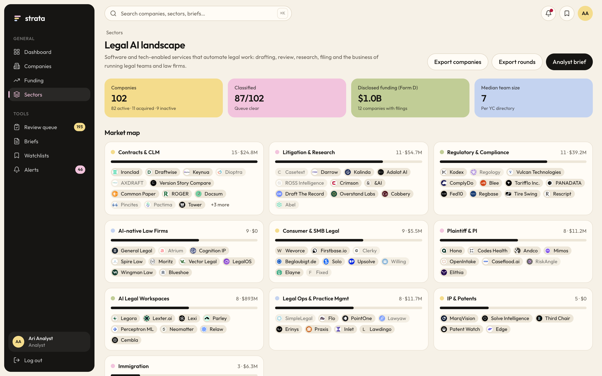

| | |
|---|---|
| **Backend** | Node.js 22 · Express 5 · TypeScript (strict) · Mongoose 8 on MongoDB 7 (aggregation pipelines) · zod |
| **Frontend** | Next.js 15 (App Router) · React 19 · SWR · Tailwind · warm pastel design system |
| **Infra** | Redpanda (Kafka API) event backbone · Redis (cache, rate limits, BullMQ jobs) · Docker Compose |
| **AI** | OpenAI, Anthropic and Gemini behind one provider interface (Gemini live in the demo, with model fallback and an offline heuristic fallback) · RAG over the dataset with Gemini embeddings and MongoDB Atlas Vector Search · 162-company hand-labelled classification eval set |
| **Data** | YC public directory · SEC EDGAR Form D · company RSS/press feeds · GitHub. No Crunchbase, PitchBook, Tracxn or LinkedIn scraping. |
| **Quality** | 110 unit/API tests · 37 Playwright end-to-end tests (flows, axe accessibility scans, mobile) · CI runs the full Docker stack; the suite also passes against the live demo |

**Read next:** [Architecture](docs/ARCHITECTURE.md) · [API reference](docs/API.md) · [Decisions log](docs/DECISIONS.md) · [Legal AI landscape (sample analysis)](docs/landscape-legal-ai.md) · [Eval results](docs/eval-results.md) · [Free hosted demo](docs/DEPLOY.md)

---

## Quick start

Requirements: Docker with Compose v2. No API keys needed.

```bash
docker compose up --build
```

Open **http://localhost:3000** (landing page) and press **Sign in**; the analyst demo account is pre-filled:

| Role | Email | Password | Can |
|---|---|---|---|
| Analyst | `analyst@strata.local` | `strata-demo-2026` | Review classifications, edit taxonomy, add rounds, generate briefs |
| Admin | `admin@strata.local` | `strata-demo-2026` | Everything above, plus run connectors and manage users |
| Viewer | `viewer@strata.local` | `strata-demo-2026` | Read, search, export, keep watchlists |

The one-shot `seed` service loads a snapshot of real public data (465 YC companies across Legal AI, Climate Tech and Payments Infrastructure, plus 136 hand-verified SEC Form D filings) through the real ingestion pipeline, so the app is full on first run. It does nothing if the database already has data.

Optional settings, in `.env` (copy `.env.example`):
- **LLM providers:** `OPENAI_API_KEY`, `ANTHROPIC_API_KEY` or `GEMINI_API_KEY`. Keys stay on the server and are never sent to the browser.
- **Live SEC data:** `SEC_USER_AGENT="Your Name you@example.com"`. SEC requires a contact; the Form D connector refuses to run without one.
- **Kafka inspection:** `docker compose --profile tools up` adds Redpanda Console at http://localhost:8080.

## Screenshots

| | |
|---|---|
| 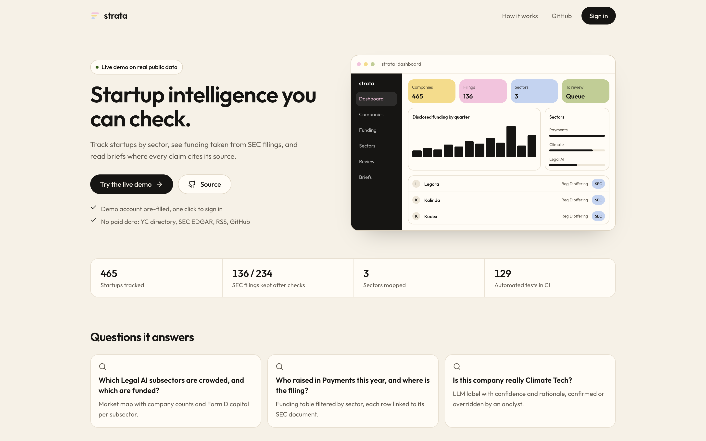 **Landing page** with a one-click route into the demo | 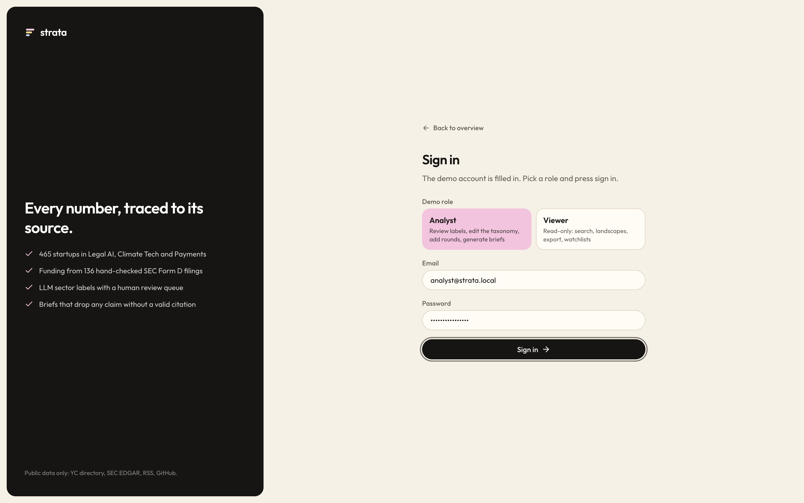 **Sign in**: demo account pre-filled, analyst or viewer role |
| 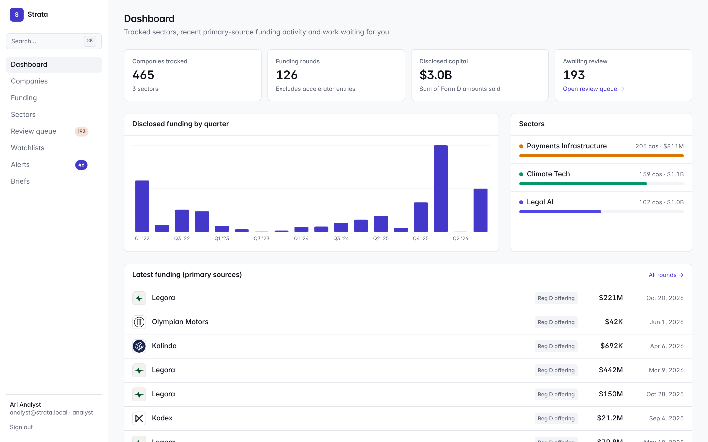 **Dashboard**: KPIs, quarterly funding, sectors, latest rounds and computed insights | 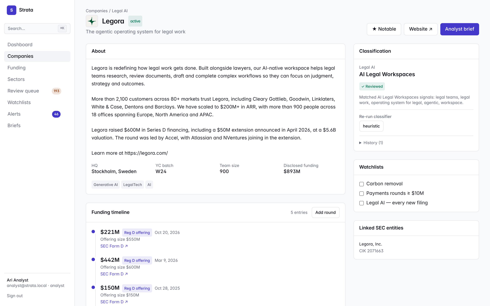 **Company profile**: Form D funding timeline, sources, classification, watchlists |
| 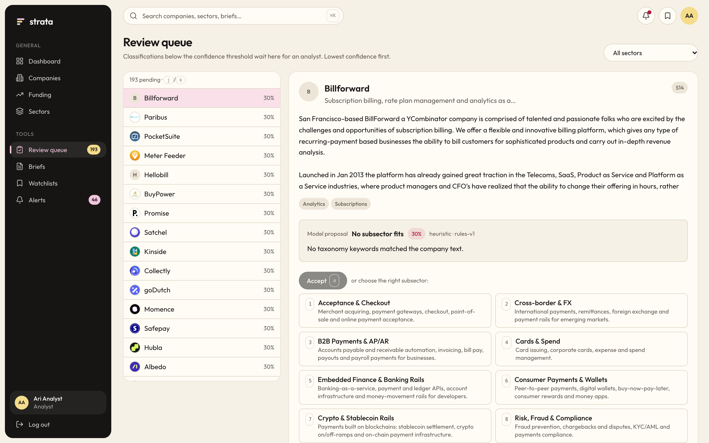 **Review queue**: keyboard-driven human review of low-confidence labels | 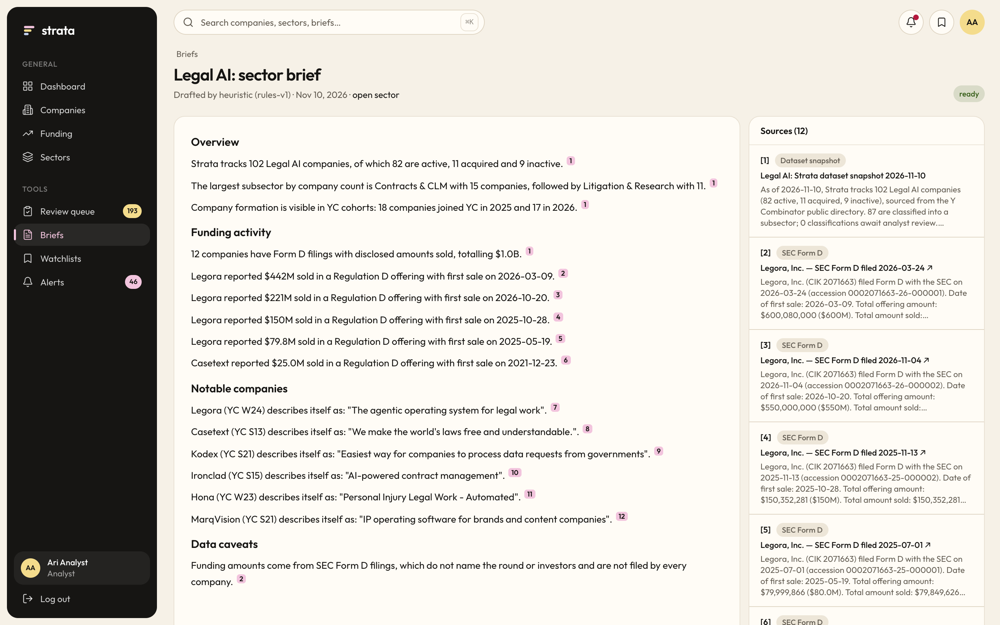 **Analyst brief**: every claim footnoted to a stored source |
| 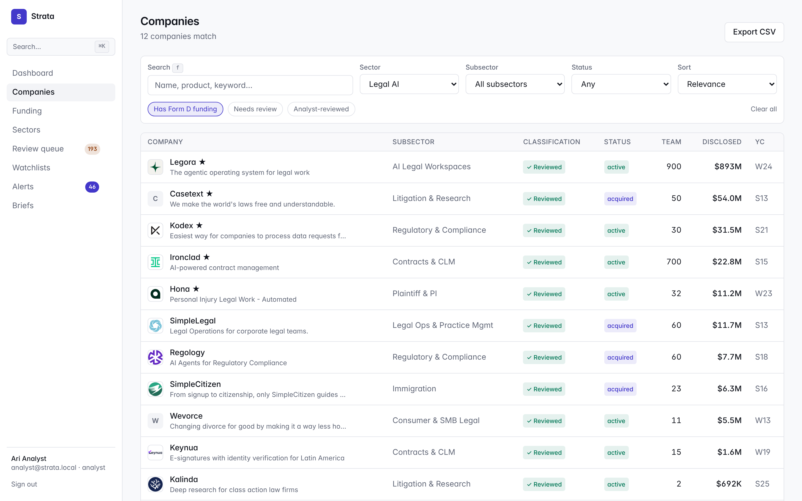 **Search and filters**, URL-shareable, CSV export | 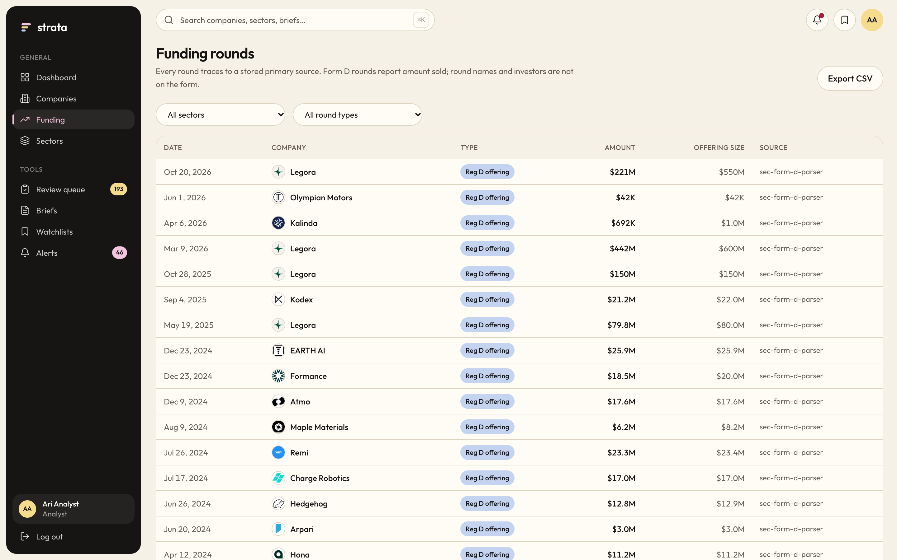 **Funding rounds**, each linked to its primary source |
| 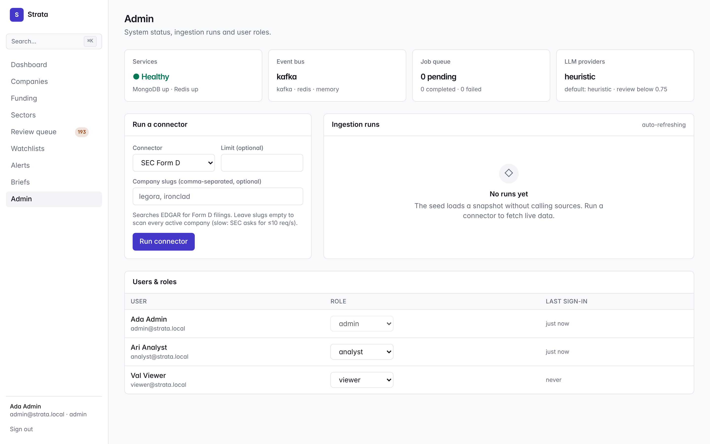 **Admin console**: service health, connector runs, roles | 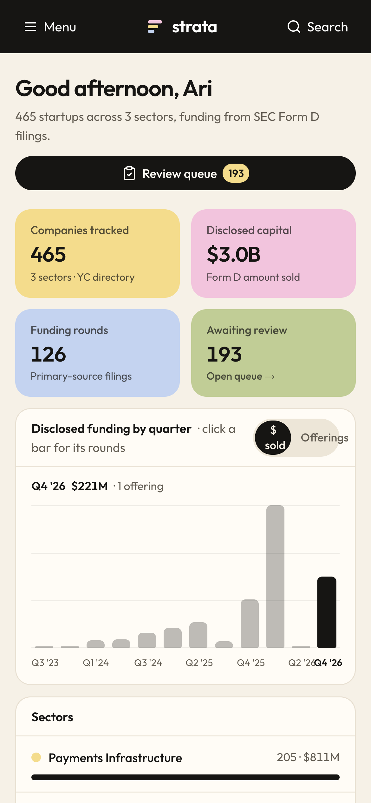 **Responsive** |

## Features

| Feature | Where |
|---|---|
| **Company profiles**: description, HQ, team, tags, linked SEC entities, every source | `/companies/[slug]` |
| **Funding-round timeline**, each entry linked to its SEC filing or press release; analysts can add a round with a citation | Company profile, `/funding` |
| **Sector taxonomy management**: add, edit and delete sectors and subsectors; definitions feed the classifier | `/sectors` |
| **LLM classification** with confidence, rationale, alternatives and history; re-run with any configured provider | Company profile |
| **Human review queue**: low-confidence labels, keyboard-driven (`j`/`k`, `a` accept, `1–9` override, `0` out of scope) | `/review` |
| **Sector landscape**: market map, Form D funding by year, YC cohort trend, notable companies, latest rounds | `/sectors/[slug]` |
| **Search and filters**: full-text and prefix search; sector, subsector, status, review state, funding; URL-shareable | `/companies`, ⌘K palette |
| **Watchlists and alerts** for new rounds, by company or subsector, with a minimum size and optional SSRF-safe webhooks | `/watchlists`, `/alerts` |
| **Ask Strata (RAG)**: questions answered from the dataset with hybrid retrieval (Gemini embeddings + Atlas Vector Search, keyword and name match, fused by reciprocal rank fusion); every sentence cites its passages and unsupported numbers are dropped | `/ask` |
| **Analyst briefs**: LLM-drafted; claims without a valid citation, or with numbers not found in the cited source, are dropped | `/briefs` |
| **CSV export** of companies and rounds (streamed, formula-injection safe) | Companies, funding and landscape pages |
| **Admin console**: MongoDB/Redis/event-bus/job-queue status, run connectors, ingestion history with partial-failure detail, user roles | `/admin` |

Keyboard: `⌘K` / `Ctrl+K` or `/` search, `g` then `d c f s q r w a b` to jump between pages (`g x` for admin), `j`/`k` and `Enter` in tables.

## How it works

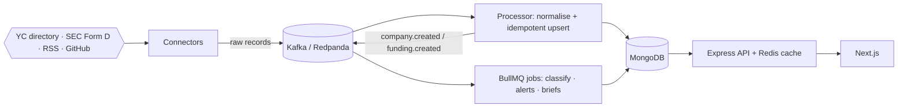

- **Ingestion is event-driven and replay-safe.** Connectors only publish; every write is an upsert on a natural key (SEC accession number, YC id, URL), so re-delivery never duplicates data. Failed messages go to a dead-letter topic.
- **The queue layer is swappable.** The same code runs on Kafka, Redis Streams or in memory (`EVENT_BUS`), so a hosted demo can run on free tiers without Kafka (`EVENT_BUS=redis INLINE_WORKER=true`, one process).
- **Analytics are MongoDB aggregation pipelines** (`$facet`, `$group`, `$lookup`), cached in Redis with generational invalidation.
- **Security** covers httpOnly-cookie JWT sessions, role checks, zod validation on every route, Redis-backed rate limits (including per-user LLM budgets), a CSP, and an SSRF-safe fetch client (DNS pinning, private-range blocking, per-hop redirect checks).

### Ask Strata: retrieval-augmented answers

- **Index.** One passage per company profile, per SEC Form D offering and per sector snapshot (about 600), embedded with Gemini `gemini-embedding-2` (768 dimensions, `RETRIEVAL_DOCUMENT`). Passages are content-hashed, so re-indexing only embeds what changed; a run that hits the free-tier rate limit waits and resumes. `npm run index`, or `POST /api/ask/reindex` as an admin.
- **Retrieve (hybrid).** Dense search uses **MongoDB Atlas Vector Search** (falls back to in-process cosine where Atlas Search is not available), plus Mongo full-text search and exact company-name matching. The three rankings are merged with **reciprocal rank fusion**, and each passage shows which retrievers found it.
- **Answer.** Gemini sees only the retrieved passages as numbered sources and must answer in cited claims, or say the dataset has no answer. The same validator as analyst briefs drops any claim that cites nothing, cites an unknown passage, or states a number not in its cited passages. If the model is unavailable the endpoint still answers with the closest passages, labelled as extractive.
- **Measured.** `npm run eval:rag` scores retrieval on hand-written paraphrase questions (Hit@1, Hit@5, MRR) for semantic-only, keyword-only and hybrid search. On 25 questions (21 paraphrases that avoid the company's own words, 4 about named companies' filings), against the live dataset:

  | Retriever | Hit@1 | Hit@5 | MRR |
  |---|---|---|---|
  | Keyword only (Mongo text search) | 20% | 52% | 0.32 |
  | Semantic only (Gemini embeddings) | 76% | **100%** | 0.84 |
  | Hybrid (weighted fusion, the default) | 72–76% | **100%** | 0.82–0.85 |

  Keyword search alone misses most paraphrases, so fusion weights it at 0.05 against 1.0 for semantic search (equal weights cut hybrid MRR to 0.69). Its value is exact rare terms and names, which these paraphrases deliberately avoid. The hybrid range covers runs on Atlas's approximate index and on exact in-process cosine. With `--answers`, five questions go through Gemini: 11 claims kept, every one cited, and the out-of-scope question ("What is Apple's stock price?") correctly refused.

The full design (ingestion and record linkage, caching, data model, scaling, failure handling, security) is in [docs/ARCHITECTURE.md](docs/ARCHITECTURE.md), and the reasoning behind each choice is in [docs/DECISIONS.md](docs/DECISIONS.md).

## Development

```bash
npm install
docker compose up -d mongo redis redpanda        # infrastructure only
cp .env.example .env
npm run seed                                     # SEED_RESET=true to start over
npm run dev:api        # http://localhost:4000   (EVENT_BUS=memory by default)
npm run dev:worker     # set EVENT_BUS=kafka KAFKA_BROKERS=localhost:19092 REDIS_URL=redis://localhost:6379 to use Kafka
npm run dev:web        # http://localhost:3000
```

| Command | What it does |
|---|---|
| `npm test` | Unit and API tests (Vitest + Supertest + in-memory MongoDB, plus real-socket SSRF tests) |
| `npm run test:e2e` | Playwright against a running stack (`BASE_URL`, default `http://localhost:3000`) |
| `npm run lint` / `npm run typecheck` | ESLint and `tsc --noEmit` for both apps |
| `npm run eval -w apps/api -- --provider anthropic` | Classification accuracy against the hand-labelled set |
| `npm run snapshot -w apps/api` | Re-crawl the YC directory and SEC EDGAR into `data/seed` (needs `SEC_USER_AGENT`) |

CI ([.github/workflows/ci.yml](.github/workflows/ci.yml)) runs lint, typecheck, tests and the eval, then builds the full Docker Compose stack and runs the Playwright suite against it.

## Repository layout

```
apps/api       Express API + worker (one image, two entry points)
  src/ai           provider interface, OpenAI/Anthropic/Gemini/heuristic, classify/extract/brief
  src/events       EventBus: Kafka, Redis Streams, in-memory
  src/ingestion    connectors (yc, sec_form_d, rss, github), processor, pipeline
  src/security     auth, validation, rate limits, SSRF-safe fetch
  src/services     classification, analytics (aggregations), briefs, alerts, taxonomy
  eval/            hand-labelled classification set
apps/web       Next.js app
data/seed      public-data snapshot, analyst reviews, Form D rejections (with reasons)
docs/          architecture, API, decisions, eval results, Legal AI landscape + CSV exports, screenshots
e2e/           Playwright tests (flows, accessibility, responsive)
```

## Data sources and terms

- **SEC EDGAR**: public filings. Requests identify themselves with a contact (`SEC_USER_AGENT`) and stay under SEC's 10 requests/second guidance.
- **Y Combinator directory**: public company profiles, via the community [yc-oss](https://github.com/yc-oss/api) JSON mirror.
- **RSS / press feeds and GitHub**: public feeds and the GitHub REST API.
- Product Hunt fits the same connector interface but needs an OAuth app token, so it is not wired up.

## Limitations

- Funding coverage depends on Form D, which does not name rounds or investors and is not filed by every company. Strata labels these "Reg D offering" and never infers a round name.
- Gemini has been evaluated on 41 of the 162 labelled companies (87.8% accuracy on Legal AI) before the free tier's 20-requests-per-day limit stopped the run; the held-out split is still to be measured. OpenAI and Anthropic are implemented but not evaluated. See [eval-results.md](docs/eval-results.md).
- The hosted demo uses Gemini's free tier. When its daily quota runs out, classification and briefs fall back to the offline heuristic and are labelled as such.
- Sessions are stateless JWTs (8 h) with no server-side revocation yet.

## License

[MIT](LICENSE)
