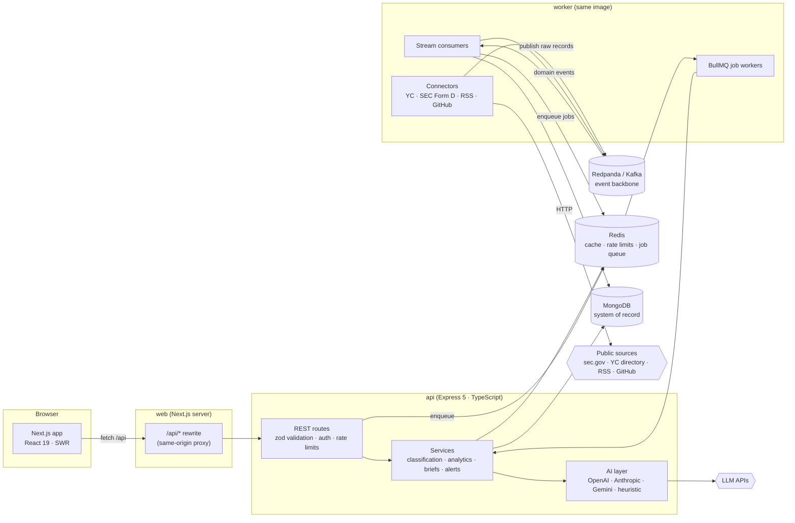
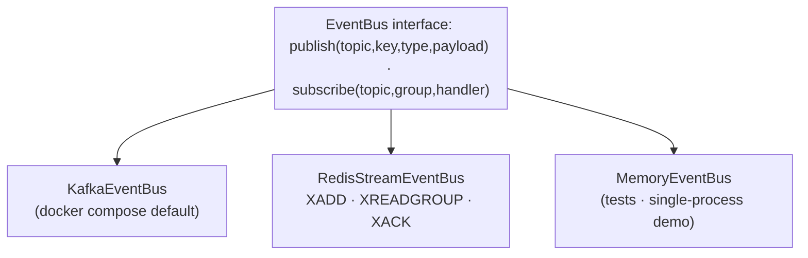
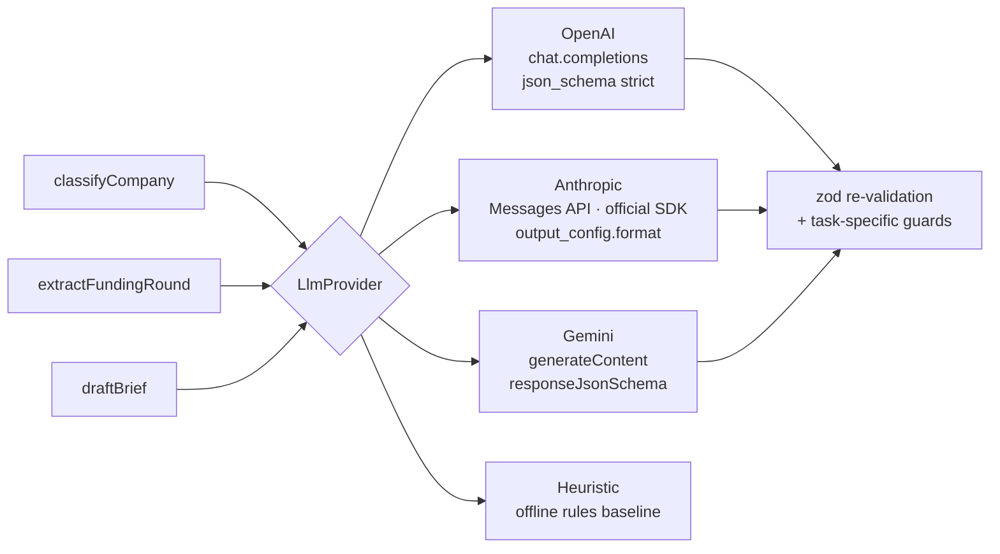
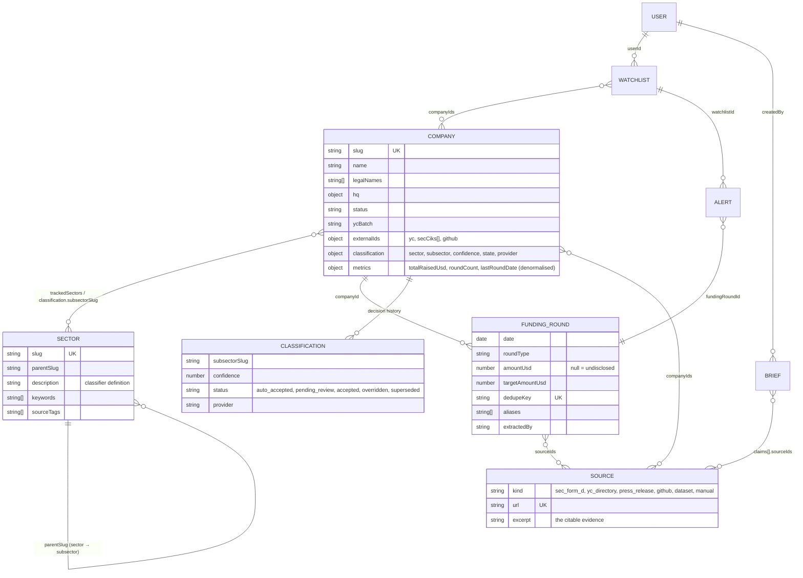
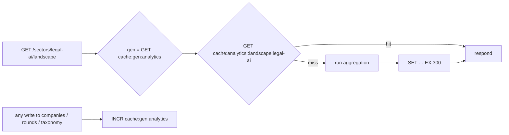

# Strata — Architecture

Strata is a startup and sector intelligence platform. It ingests public data about startups (the Y Combinator directory, SEC Form D filings, press-release feeds and GitHub), links the records to companies, classifies each company into an editable sector taxonomy with an LLM, and produces sector landscapes and analyst briefs in which every claim cites a stored source.

This document covers the components, the ingestion pipeline, caching, the data model, scaling and failure handling, and security. Design choices and their trade-offs are in [DECISIONS.md](DECISIONS.md).

---

## 1. Components



| Component | Responsibility | Tech |
|---|---|---|
| **web** | UI; proxies `/api/*` to the API so the browser only talks to its own origin (session cookie stays first-party and `httpOnly`; LLM keys never reach the client). | Next.js 15 (App Router), React 19, SWR, Tailwind |
| **api** | REST API: auth, validation, search, analytics, review decisions, watchlists, brief requests. Stateless; scale horizontally. | Express 5, TypeScript, Mongoose 8, zod |
| **worker** | Consumes the event streams (normalise + upsert), runs background jobs (classification, alert fan-out, briefs, connector runs) and optional schedules. Same image as the API, different entry point. | kafkajs, BullMQ |
| **MongoDB** | System of record: companies, funding rounds, sources, taxonomy, classifications, watchlists, alerts, briefs, ingest runs. Analytics are aggregation pipelines. | MongoDB 7 |
| **Redpanda** | Kafka-compatible event log between connectors and processors (replayable, partitioned, consumer groups). | Redpanda 24 (Kafka API) |
| **Redis** | Cache for aggregation results, distributed rate-limit counters, and the BullMQ job queue. | Redis 7 |

The worker and API share one codebase and one Docker image (`apps/api`), started with `node dist/server.js` or `node dist/worker.js`.

---

## 2. Ingestion pipeline: sources → Kafka → workers → MongoDB

```mermaid
sequenceDiagram
  autonumber
  participant Sch as Scheduler / admin trigger
  participant Con as Connector (worker)
  participant Src as Public source
  participant K as Kafka: strata.ingest.raw
  participant P as Processor (consumer group "processor")
  participant DB as MongoDB
  participant E as Kafka: strata.company.created / strata.funding.created
  participant Q as BullMQ (Redis)

  Sch->>Q: run-connector {connector, params}
  Q->>Con: job
  Con->>Src: fetch (rate-limited, identified User-Agent)
  Src-->>Con: JSON / XML / RSS
  Con->>K: publish RawRecord (key = natural id, e.g. sec:<cik>)
  K->>P: deliver (at-least-once)
  P->>DB: idempotent upserts: Source, Company, FundingRound
  P->>E: company.created / funding.created
  E->>Q: classify-company / deliver-alerts (jobId dedupes)
  Q->>DB: Classification + company snapshot; Alerts (+ SSRF-safe webhook)
```

### Connectors

| Connector | Source | What it produces | Notes |
|---|---|---|---|
| `yc` | Public YC company directory (via the [yc-oss](https://github.com/yc-oss/api) JSON mirror) | Company profile, YC batch (as an *accelerator* round with undisclosed amount), directory source | Companies enter a sector when their directory tags match the sector's `sourceTags`. |
| `sec_form_d` | SEC EDGAR full-text search + Form D `primary_doc.xml` | Reg D offering round (amount sold, offering size, first-sale date), SEC source | Throttled to < 10 req/s with a contact User-Agent, as SEC asks. Conservative record linkage (below). |
| `rss` | Company newsroom / press-release feeds (RSS 2.0 or Atom) | Press-release source; LLM-extracted funding round when the item announces one | Feed URLs are user-supplied → fetched through the SSRF guard. |
| `github` | GitHub REST API | Traction source (repos, stars) | Optional token. |

Connectors **only publish**; they never write to MongoDB. Product Hunt is a natural fifth connector (same interface); it is not implemented because its API requires an OAuth app token.

### Record linkage (Form D)

A Form D is filed by a legal entity (`Legora, Inc.`), not a brand (`Legora`). The matcher accepts a filing only if:

1. the normalised entity name equals the company name, or equals it plus one allowed suffix (`software`, `technologies`, `labs`, `ai`, …), or matches the website's domain stem;
2. the entity is not a fund/SPV vehicle (`Fund`, `SPV`, `L.P.`, `a Series of`, …);
3. the filing is date-plausible: not filed more than four years before the company's YC batch, and the issuer was not incorporated more than six years before it;
4. no analyst has rejected that CIK for that company (`data/seed/sec-form-d-rejections.json`).

For the seed snapshot this kept 141 of 234 candidate filings; 37 rejections were made by hand with written reasons. Precision is preferred over recall: a wrong funding round is worse than a missing one.

### Amendments and idempotency

Every write is an upsert on a natural key, so replaying a topic never duplicates data:

| Entity | Key |
|---|---|
| Company | `externalIds.yc` |
| Source | `url` |
| FundingRound | `dedupeKey` (`sec:<accession>`, `yc:<id>`, `press:<company>:<month>:<type>`, `manual:…`) |
| Alert | unique `(userId, fundingRoundId)` |

A Form D/A amendment carries `previousAccessionNumber`; the processor folds it into the original offering's round (stored in `aliases`) and only lets a *later* filing overwrite the amount (`asOf`).

### Topics

| Topic | Key | Producer → consumer group |
|---|---|---|
| `strata.ingest.raw` | `<connector>:<natural id>` | connectors → `processor` |
| `strata.company.created` | `company:<slug>` | processor → `classifier` (enqueues `classify-company`) |
| `strata.funding.created` | `company:<slug>` | processor, manual entry → `alerts` (enqueues `deliver-alerts`) |
| `<topic>.dlq` | original key | any consumer after retries are exhausted |

Keys put all events for one entity on one partition, so they are processed in order.

### Queue layer: Kafka *or* Redis Streams *or* in-memory



`EVENT_BUS=kafka | redis | memory` selects the transport. All three give the same at-least-once contract, consumer groups, bounded retries with backoff and a dead-letter topic. A hosted demo can therefore run **without Kafka**:

| Deployment | Settings | Processes |
|---|---|---|
| Local / full | `EVENT_BUS=kafka`, `REDIS_URL` set | api, worker, Redpanda, Redis, MongoDB |
| Hosted demo (free tiers) | `EVENT_BUS=redis`, `INLINE_WORKER=true`, Redis + MongoDB free tier | one API process |
| Minimal demo / tests | `EVENT_BUS=memory`, no `REDIS_URL` | one process; cache, rate limits and jobs fall back to in-process |

**Kafka vs BullMQ.** Kafka carries *facts* (what was ingested, what changed): a replayable log that several consumer groups read independently. BullMQ carries *work* (do this once): retries with exponential backoff, concurrency limits, job ids for deduplication, scheduled repeatable jobs and inspectable state.

---

## 3. AI layer



- **One interface.** `LlmProvider.generateJson({system, user, jsonSchema, zod})`. Each provider uses its native structured-output feature, and the output is re-validated with zod, because providers can still return invalid JSON, refuse, or truncate. The provider is chosen per request (`provider` field) or by `LLM_DEFAULT_PROVIDER`; only providers with a configured key are offered.
- **Prompt hygiene.** System prompts are static (cache-friendly). Untrusted text (company descriptions, press releases, source excerpts) is fenced in tags and labelled *data, not instructions*.
- **Classification** returns a subsector (or `null` = out of scope), a confidence and a rationale. Slugs the model invents are rejected. If the confidence is at or above `REVIEW_CONFIDENCE_THRESHOLD` (0.75), the label is auto-accepted; otherwise it goes to the human **review queue**. An analyst decision is final: automatic runs never overwrite it.
- **Extraction** must return a verbatim evidence sentence. If the sentence is not in the document, the extraction is discarded; if the amount disagrees with the sentence, the amount is taken from the sentence.
- **Briefs** see only an *evidence pack* of numbered stored sources. Aggregates are first written to a citable "dataset snapshot" source. `validateClaims` drops any claim that has no citation, cites an unknown source, or contains a number that does not appear in the sources it cites. Rejected claims are kept for audit but never shown as fact.
- **Heuristic provider.** A deterministic keyword model, so the whole product, the eval and CI run without API keys. It is also the baseline the LLMs are measured against.

### Evaluation

`npm run eval -- --provider <name>` scores a provider against 162 hand-labelled companies (`apps/api/eval/classification.jsonl`): accuracy, macro-F1, and the review-queue trade-off (share auto-accepted at the threshold, and the accuracy of those auto-accepted labels). Results are in [eval-results.md](eval-results.md).

---

## 4. Data model



**Why documents.** A company profile is read far more often than it is written, so the hot read path (`/companies/:slug`) is one document plus two indexed lookups. Rounds and sources are separate collections because they grow without bound and are queried on their own (feeds, exports, citations). `Company.metrics` is a denormalised summary recomputed after every round write, so list sorting and filtering never need a join.

**Key indexes.** A weighted text index (`name` 10, `oneLiner` 4, `tags` 3, `description` 1) plus a `name` index for prefix search; `classification.sectorSlug + subsectorSlug`; `classification.state`; `metrics.totalRaisedUsd`; `fundingrounds.date` and `(companyId, date)`; unique `dedupeKey`, `source.url`, `(alert.userId, fundingRoundId)`.

**Analytics are aggregation pipelines.** The landscape endpoint runs one `$facet` over companies (KPIs, market map grouped by subsector, YC cohort trend, unclassified count), then grouped `$lookup` pipelines over funding rounds (by year, by subsector and year, latest rounds). The dashboard computes per-quarter totals with `$year`, `$month`, `$ceil`, and per-sector rollups with `$unwind` and `$lookup`.

---

## 5. Caching



- **Cache-aside with generational invalidation.** Keys include a per-namespace generation number. Writes call `invalidate(ns)`, which increments it, so stale keys are never read again and simply expire. This avoids `SCAN`/`DEL` storms and is safe across many API replicas.
- **Namespaces:** `analytics` (landscapes, dashboard) and `taxonomy` (tree with counts).
- **Degradation:** if Redis is down, requests bypass the cache instead of failing. With no `REDIS_URL`, a bounded in-process map is used.
- **What is not cached:** per-user data (watchlists, alerts) and search results, which are cheap indexed queries.

---

## 6. Scaling

| Pressure | Approach |
|---|---|
| Read traffic | Stateless API replicas behind a load balancer; Redis cache for aggregations; MongoDB read replicas (`readPreference=secondaryPreferred`) for analytics. |
| Ingestion volume | More topic partitions (6 per topic by default) and more worker replicas: the consumer group spreads partitions across them. Per-entity keys keep per-company ordering. |
| Slow or expensive jobs (LLM) | BullMQ concurrency per worker, plus more workers; jobs are independent and idempotent. LLM calls have per-user hourly rate limits. |
| Search relevance at scale | MongoDB text search is adequate for thousands of companies. The next step is Atlas Search or Elasticsearch fed from the same `company.*` events (a new consumer group, no change to producers). |
| Data size | Shard `fundingrounds` and `sources` on `companyId` (hashed) once single-node limits bite; analytics already filter by company id. |
| Many sectors / taxonomies | The taxonomy is data, not code: add a tracked sector with `sourceTags` and the YC connector picks it up on the next run. |

## 7. Failure handling

| Failure | Behaviour |
|---|---|
| Source down / 429 / 5xx | Connectors retry with exponential backoff (SEC: 4 attempts); the run is recorded in `ingest_runs` with counts and the error; other targets continue. |
| Poison message | `runWithRetry` retries 3× with backoff, then publishes to `<topic>.dlq` and moves on, so one bad record never blocks a partition. |
| Worker crash mid-message | Kafka offsets and Redis Stream acks happen after the handler, so the message is redelivered. Idempotent upserts make redelivery safe. |
| Duplicate delivery | Natural-key upserts; unique alert index; BullMQ `jobId` deduplication. |
| LLM timeout, refusal, bad JSON | 30 s timeout, bounded retries on 429/5xx; refusals, truncation and schema-invalid output raise `LlmError`; classification jobs retry via BullMQ (4 attempts), and briefs are marked `failed` with the reason. Nothing unvalidated is stored. |
| Redis outage | Cache bypassed; rate limits and queues are degraded (the API stays up for reads); BullMQ reconnects. |
| MongoDB unavailable | `/api/health` returns 503 so the load balancer drains the instance; startup retries the connection with backoff. |
| Bad deploy of taxonomy | Taxonomy nodes in use cannot be deleted; analyst decisions are never overwritten by automatic runs. |

Graceful shutdown (SIGTERM) closes the HTTP server, workers, consumers and connections in order.

---

## 8. Security

| Area | Control |
|---|---|
| **Authentication** | bcrypt (cost 12) password hashes; HS256 JWT (8 h) in an `httpOnly`, `SameSite=Lax` cookie (`Secure` behind HTTPS); `Authorization: Bearer` for API clients; the same error for unknown email and wrong password. |
| **Authorisation** | Roles `viewer < analyst < admin`, checked on every route. Self-registration always creates a viewer. Owner-scoped resources (watchlists, alerts) return 404 for other users' ids. |
| **Input validation** | Every route parses `params`, `query` and `body` with zod; parsed objects contain only declared keys and primitives, which stops NoSQL operator injection (`{"$gt": ""}`). Regex search input is escaped. JSON bodies only, limited to 100 kB. |
| **CSRF** | `SameSite=Lax` cookie, a JSON-only content-type check on writes, and a CORS allow-list. |
| **Rate limiting** | Redis-backed (shared across replicas): 300 requests/min per user or IP; 20 failed logins per 15 min per IP; 60 LLM-backed operations per hour per user. IPv6 clients are keyed by /56. |
| **Secrets** | Only in server environment variables (`.env` is git-ignored; `.env.example` documents them). The browser never sees LLM keys: it talks to the Next.js origin, which proxies to the API. Logs redact `authorization`, cookies, passwords and keys. Production refuses to start with the default JWT secret. |
| **Safe outbound fetching (SSRF)** | `safeFetch`: http/https only, default ports, no credentials in URLs; DNS is resolved and *every* address must be public unicast (blocks loopback, RFC 1918, link-local incl. 169.254.169.254, CGNAT, ULA, IPv4-mapped IPv6, multicast…); the socket is pinned to the vetted IP (no DNS rebinding); redirects are re-validated hop by hop; timeouts and size caps. Webhook URLs are validated when saved and again when sent. |
| **LLM safety** | Untrusted text is fenced as data; outputs are schema-validated; invented taxonomy slugs are rejected; extraction must quote its evidence; brief claims must cite sources and pass the numeric check; low-confidence labels need a human. |
| **Output** | CSV exports neutralise spreadsheet formulas (`=`, `+`, `-`, `@`); React escapes HTML; external links use `rel="noopener noreferrer nofollow"`; Helmet and Next headers set `nosniff`, `frame-ancestors 'none'` / `X-Frame-Options: DENY` and a restrictive API CSP. |
| **Containers** | Non-root `node` user, production dependencies only, database ports bound to `127.0.0.1` in Compose. |

### Threats not addressed (yet)

Multi-factor auth, refresh-token rotation and server-side session revocation, per-tenant data isolation, and audit-log export. These would be next for a multi-customer deployment.
